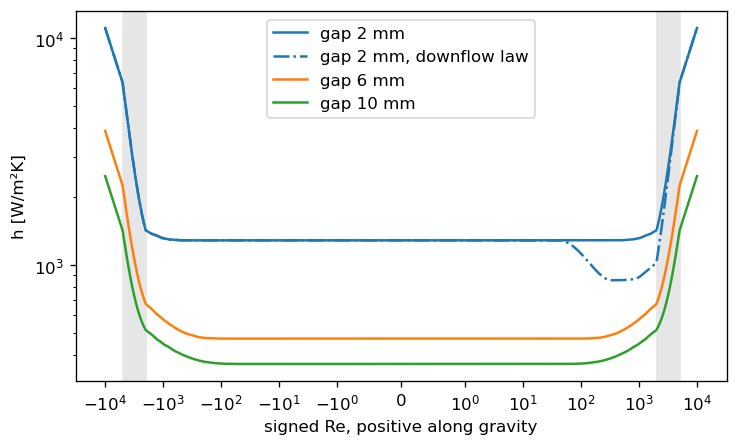
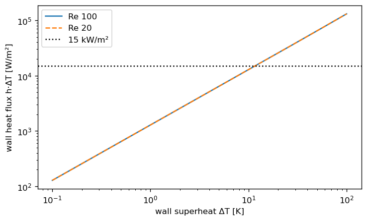

=========================
Heat Transfer Coefficient
=========================

For more information regarding limits, please see :ref:`Thresholds`.

**Some explanation regarding the jargon of this module:**

- SPL - Single Phase Liquid region.
- INC - Incipience Point, beyond which boiling occurs.
- SCB - Subcooled Boiling region.

In this module several functions relating to the calculation of the
heat transfer coefficient between coolant and walls are defined.
The most significant point of contact between this subpackage and the rest of :ref:`STREAM <STREAM>`
is through the :func:`~stream.physical_models.heat_transfer_coefficient.wall_heat_transfer_coeff` function:

.. autofunction:: stream.physical_models.heat_transfer_coefficient.wall_heat_transfer_coeff

The last five arguments are functions used to control the general behavior of this function. We shall walk through those
options one by one:

#. :ref:`Single Phase Liquid (SPL)`
#. :ref:`Subcooled Boiling (SCB)`
#. :func:`Partial SCB <stream.physical_models.heat_transfer_coefficient.subcooled_boiling.Bergles_Rohsenhow_partial_SCB>`
#. :func:`Film <stream.physical_models.heat_transfer_coefficient.temperatures.film_temperature>`
#. :func:`Incipience <stream.physical_models.heat_transfer_coefficient.temperatures.Bergles_Rohsenow_T_ONB>`

.. [#BR] A. E. Rohsenow, W. M. Bergles, "The Determination of Forced Convection
        Surface Boiling Heat Transfer", Journal of Heat Transfer, 1964, p. 385
.. [#Collier] J. G. Thome, J. R. Collier, "Convective Boiling and Condensation",
    Oxford Science, 1994

Single Phase Liquid (SPL)
=========================

.. autofunction:: stream.physical_models.heat_transfer_coefficient.single_phase.spl_htc

.. autoclass:: stream.physical_models.heat_transfer_coefficient.SinglePhaseLiquidHTC
    :special-members: __call__
    :undoc-members:
    :show-inheritance:

.. autoclass:: stream.physical_models.heat_transfer_coefficient.single_phase.SinglePhaseLiquidHTCExArgs
    :special-members: __call__
    :undoc-members:
    :show-inheritance:

Turbulent Heat Transfer Coefficient
-----------------------------------

.. automodule:: stream.physical_models.heat_transfer_coefficient.turbulent
   :undoc-members:
   :members:

Laminar Heat Transfer Coefficient
---------------------------------

.. automodule:: stream.physical_models.heat_transfer_coefficient.laminar
   :undoc-members:
   :members:

Natural (Free) Convection Heat Transfer Coefficient
---------------------------------------------------

.. autofunction:: stream.physical_models.heat_transfer_coefficient.natural_convection.Elenbaas_h_spl

Composed HTC Functions
----------------------

.. autofunction:: stream.physical_models.heat_transfer_coefficient.single_phase.regime_dependent_h_spl
.. autofunction:: stream.physical_models.heat_transfer_coefficient.single_phase.maximal_h_spl

Low flow, reversal and natural circulation
~~~~~~~~~~~~~~~~~~~~~~~~~~~~~~~~~~~~~~~~~~

As a channel's flow falls, :func:`~.regime_dependent_h_spl` moves from Dittus-Boelter through the
``re_bounds`` band to the developing laminar law, and at zero flow the laminar law holds its fully
developed value. Without the downflow law the coefficient is therefore continuous through stagnation and
the same on both sides of it. The Elenbaas natural term is added to the forced value by the cube norm at
every flow: in a 2 mm gap at up to 30 K superheat it adds under 1 %; the gain grows roughly as the fourth
power of the gap and with the superheat, and from about 4 mm it lifts the low-flow value.

   Wall HTC of a 70 mm wide heated channel at 10 K superheat against signed Re, with the ``re_bounds`` band shaded.

Every switch in the law is fed by the flow, never by the wall superheat the coefficient feeds back
into, and the cube norm only adds. The wall heat flux :math:`h \cdot \Delta T` then rises monotonically
with the superheat, so a flow-fed closure gives a cell's wall balance one root per heat flux.

   Wall heat flux against superheat in a 2 mm gap at Re 100 and Re 20, which coincide on the held laminar value, crossing a 15 kW/m² flux once.

The channel's orientation enters through ``g``, the same gravity its pressure law
(:func:`~.pressure_diff`) uses: positive flow runs along gravity when ``g > 0``, a riser passes the
negated gravity and a horizontal channel passes ``0.0``, which drops the natural term. Laminar flow along
gravity past a heated wall is slowed at the wall by buoyancy, which the default law ignores and so
over-predicts. Passing ``downflow="sudo"`` scales the laminar value by :func:`~.Sudo_downflow_ratio`,
from the narrow-channel measurements of Sudo et al. (about half the laminar coefficient at Re 250 to 400),
on the local Graetz number; the law applies the ratio of Sudo's downflow and upflow envelopes, never below
2/3, and it needs ``develop_length``. It lowers the coefficient and raises the wall
temperature, the conservative side, and is off by default.

Incipience (INC)
================

.. autoclass:: stream.physical_models.heat_transfer_coefficient.IncipienceTemperatureFunction
    :special-members: __call__
    :undoc-members:
    :show-inheritance:

.. autofunction:: stream.physical_models.heat_transfer_coefficient.temperatures.Bergles_Rohsenow_T_ONB

Subcooled Boiling (SCB)
=======================

The subcooled boiling region is identified with a fully subcooled flux function, whose protocol is

.. autoclass:: stream.physical_models.heat_transfer_coefficient.SubCooledBoilingFluxFunction
    :special-members: __call__
    :undoc-members:
    :show-inheritance:

Several SCB flux correlations are available:

.. autofunction:: stream.physical_models.heat_transfer_coefficient.subcooled_boiling.McAdams_SCB_heat_flux
.. autofunction:: stream.physical_models.heat_transfer_coefficient.subcooled_boiling.Bergles_Rohsenhow_SCB_heat_flux
.. autofunction:: stream.physical_models.heat_transfer_coefficient.subcooled_boiling.regime_dependent_q_scb

and an interpolation scheme, which is
:func:`~stream.physical_models.heat_transfer_coefficient.subcooled_boiling.Bergles_Rohsenhow_partial_SCB`.

.. autofunction:: stream.physical_models.heat_transfer_coefficient.subcooled_boiling.Bergles_Rohsenhow_partial_SCB

In protocol form:

.. autoclass:: stream.physical_models.heat_transfer_coefficient.PartialSCBFactorFunction
    :special-members:
    :undoc-members:
    :show-inheritance:

Wall Temperature Closure
========================

.. autofunction:: stream.physical_models.heat_transfer_coefficient.temperatures.wall_temperature

Note that the wall temperature is also used to determine the film temperature:

.. autoclass:: stream.physical_models.heat_transfer_coefficient.FilmFunction
    :special-members: __call__
    :undoc-members:
    :show-inheritance:

.. autofunction:: stream.physical_models.heat_transfer_coefficient.temperatures.film_temperature
