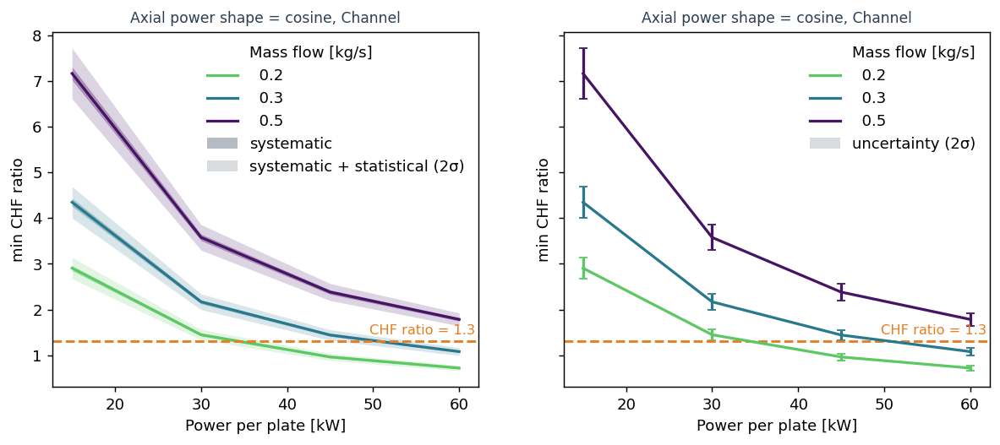
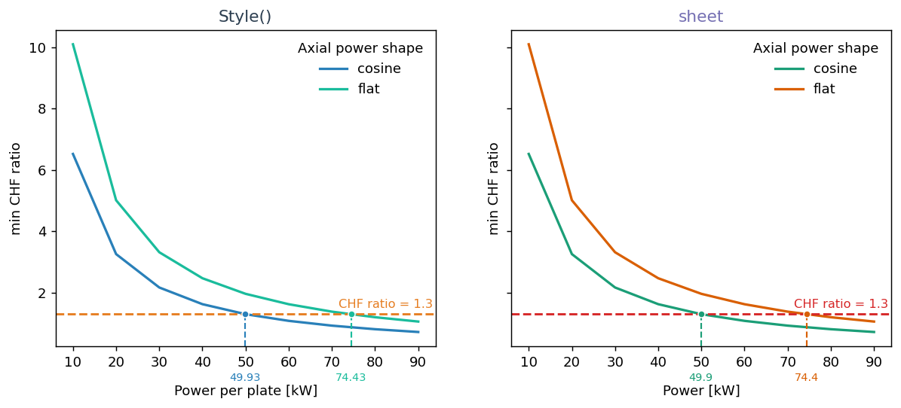

Plot a sweep
============

:mod:`stream.viz` turns a steady-state parameter sweep into figures and tidy data.
Build a :class:`~stream.viz.Sweep` from the cases and their result frames, ask it a question, and call ``.plot()`` on the answer, or read its ``frame``.

Each task below starts from what you want to look at and ends at the call that draws it.
The figures come from ``docs/viz_figures.py``, a fuel plate and its coolant channel solved over ten powers, six mass flows and two axial power shapes, and the uncertainty figure from a smaller banded sweep.

Build the sweep
---------------

A sweep needs three things: the cases, one frame per case, and the aggregator the frames came from.
A frame is ``State.to_dataframe()`` of a solved case, so the model is any function that takes one case's parameters as keywords, solves it and returns that frame.

.. code-block:: python

    from stream.viz import Sweep, at_least, at_most, cases, run_cases

    cases_ = cases(power=[20e3, 40e3, 60e3, 80e3], mdot=[0.2, 0.3], shape=["cosine", "flat"])
    frames = run_cases(model, cases_)
    sweep = Sweep(cases_, frames, agr,
                  labels={"power": ("Power per plate", "kW", 1e-3),
                          "mdot": ("Mass flow", "kg/s"),
                          "shape": ("Axial power shape", ""),
                          "OSVR": ("OSV ratio", ""),
                          "CHFR": ("CHF ratio", ""),
                          "T_wall, left": ("Clad surface temperature", "°C")},
                  limits={"OSVR": at_least(1.3), "CHFR": at_least(1.3), "T_wall, left": at_most(110.0)})
    print(sweep)

- :func:`~stream.viz.cases` makes one dict per combination of levels; a parameter can be a number or a string (a choice, such as a wall law).
- ``labels=`` gives each name its display text, unit and scale; ``"power": ("Power per plate", "kW", 1e-3)`` prints watts as kilowatts.
- ``limits=`` declares what the design must respect; a declared limit is drawn on every figure that shows its quantity.

Cases and frames from your own loop work the same way: ``Sweep(cases_, frames, agr)`` with ``None`` in the slot of a case that did not solve.
``print(sweep)`` says what can be asked of the sweep:

.. code-block:: text

   Sweep: 120 cases, 34 holes (0 filled), no uncertainty
     parameters: power [10000, 20000, ..., 100000], mdot [0.1, 0.15, 0.2, 0.3, 0.4, 0.5], shape [cosine, flat]
     Channel: CHF (profile), CHFR (profile), ..., OSVR (profile), ..., T_cool (profile), T_in (scalar), ..., T_wall, left (profile), ...
     Fuel: T (field), T_wall_left (profile), T_wall_right (profile)
     limits: OSVR at least 1.3, CHFR at least 1.3, T_wall, left at most 110
     holes: case 36 (power=40000, mdot=0.1, shape=cosine): scaled_newton failed at iteration 53 (Armijo line search found no descent direction); ||F||=3.906e+06.
            case 37 (power=40000, mdot=0.1, shape=flat): scaled_newton failed at iteration 100 (exceeded maxit=100); ||F||=nan.
            ...

A profile has one value per cell along the channel, a field one value per cell over a plate's two axes, and a scalar one value per case.

See a quantity along the channel
--------------------------------

.. code-block:: python

    sweep.profile(["T_cool", "T_wall, left"], where=dict(power=40e3, mdot=0.2, shape="cosine")).plot()

.. figure:: ../_static/viz/profile.png
   :width: 100%

- ``where=`` fixes parameters at grid levels; every parameter it leaves free draws one line per level.
- Several quantities share one axis when they share a unit, and each gets its own colour.
- ``plot(color="power")`` puts a free parameter on colour; ``style=`` and ``marker=`` take the next ones.

For a plate, ``sweep.field("T", of="Fuel", where=dict(power=40e3, mdot=0.2, shape="cosine")).plot()`` draws one case's temperature over both axes.

See how the worst value moves with a parameter
----------------------------------------------

.. code-block:: python

    sweep.reduce("OSVR", "min", versus="power", where=dict(shape="cosine")).plot(color="mdot", crossing="mark")

.. figure:: ../_static/viz/curves.png
   :width: 100%

- The reducer collapses each case to one number: ``"min"`` or ``"max"`` for the worst value; the reference below lists the others.
- ``versus=`` is the parameter on the x axis; ``plot(color="mdot")`` gives each mass flow its own line.
- ``plot(crossing="mark")`` marks where each line meets its limit and prints the value under the axis.

.. code-block:: python

    sweep.reduce("T_wall, left", "max", versus="power").plot(color="mdot", col="shape", show_limit="shade")

.. figure:: ../_static/viz/panels.png
   :width: 100%

- ``plot(col="shape")`` draws one panel per level; ``row=`` adds a second direction.
- ``plot(show_limit="shade")`` hatches the unsafe side of the limit; the default ``"line"`` draws only the dashed line.

See the worst value over two parameters
---------------------------------------

.. code-block:: python

    sweep.reduce("OSVR", "min", versus=("power", "mdot"), where=dict(shape="cosine")).plot(show_limit="shade")

.. figure:: ../_static/viz/map.png
   :width: 100%

- A pair on ``versus=`` makes a map: filled contours over the two parameters.
- The declared limit is a contour; with ``show_limit="shade"`` its unsafe side is hatched.
- When the reducer is the limit's own (``"min"`` for ``at_least``, ``"max"`` for ``at_most``), the limit contour is the curve of the next task.

Find how far a parameter can go
-------------------------------

.. code-block:: python

    sweep.required(["OSVR", "CHFR", "T_wall, left"], solve_for="power", versus="mdot", limiting=True).plot(color="shape")

.. figure:: ../_static/viz/required.png
   :width: 100%

- ``solve_for=`` is the parameter walked until the quantity meets its limit, ``versus=`` the parameter on the x axis.
- ``equals=`` replaces the declared limit with a number, a dict per quantity, or the name of another quantity.
- ``limiting=True`` keeps, at each level, only the quantity that binds; the markers say which one.

Read ``.frame`` for the numbers: one row per level with ``lower``, ``value``, ``upper`` and ``safe``, the side of the crossing where the design is safe.

See the uncertainty
-------------------

A model that returns its frame with ``uq_attach`` bands gives a banded sweep: the ``sys`` and ``stat`` columns become ``lower`` and ``upper`` envelopes in every answer.

.. code-block:: python

    from functools import partial

    import matplotlib.pyplot as plt

    from stream.analysis.UQ import UQModel, Uncertainty

    def banded(power, mdot, shape):
        uq = UQModel(dict(power=power, mdot=mdot), partial(model, shape=shape))
        return uq.uq_attach(power=Uncertainty(systematic_relative=0.02), mdot=Uncertainty(statistical_relative=0.03))

    few = cases(power=[15e3, 30e3, 45e3, 60e3], mdot=[0.2, 0.3, 0.5], shape="cosine")
    banded_sweep = Sweep(few, run_cases(banded, few), agr, labels=sweep.labels, limits=sweep.limits)
    chfr = banded_sweep.reduce("CHFR", "min", versus="power", sigma=2.0)
    fig, (left, right) = plt.subplots(1, 2, figsize=(11, 4.2), sharey=True)
    chfr.plot(ax=left, color="mdot", band="split")
    chfr.plot(ax=right, color="mdot", errorbars=True)

- ``UQModel`` solves each case once more per uncertain parameter, so the banded sweep above is a small grid of the cosine shape.
- ``band=`` draws ``"total"`` (the default), ``"split"`` or ``"none"``. On the left, ``"split"`` shades the systematic part darker inside the total band; the total band reaches ``sys`` plus two ``stat`` from the line, because the question uses ``sigma=2.0``.
- ``plot(errorbars=True)`` draws the total band as error bars at each case, as on the right.
- ``sigma=`` on the question is the multiple of ``stat`` in the envelopes; ``sys`` is added as it is.
- ``plot(bound="lower")`` or ``bound="upper"`` draws an envelope instead of the nominal value, and a crossing or a limit contour follows it.

Handle cases that did not solve
-------------------------------

A case whose solve failed is a hole: its frame is ``None``, and ``run_cases`` keeps the solver's message.
The sweep warns once with every hole, and each question warns again with the holes it skips; the map above marks them with crosses.

.. code-block:: python

    patched = Sweep(cases_, frames, agr, fill_holes=True)
    print(patched.holes, patched.filled)

- ``fill_holes=True`` interpolates a hole between its two solved neighbours along a numeric parameter; a hole at the edge of the sweep, or next to another hole, stays a hole.
- A filled case draws with an open marker and carries ``filled=True`` in every frame, and ``required`` warns when a crossing rests on it.
- ``patched.holes`` maps each hole to its message and ``patched.filled`` each filled hole to the cases it was interpolated from.

Run the cases in parallel
-------------------------

``run_cases`` runs the cases one after the other.
``mapper=`` takes any map that keeps the order of the cases, called as ``mapper(f, cases)``:

.. code-block:: python

    from concurrent.futures import ProcessPoolExecutor, ThreadPoolExecutor

    import dask

    with ThreadPoolExecutor() as pool:
        frames = run_cases(model, cases_, mapper=pool.map)
    with ProcessPoolExecutor() as pool:
        frames = run_cases(model, cases_, mapper=pool.map)
    frames = run_cases(model, cases_, mapper=lambda f, xs: dask.compute(*(dask.delayed(f)(x) for x in xs)))

- A process pool pickles the model, so the model must be a function defined at module level; threads and dask take any callable.
- ``catch=`` is the tuple of exceptions that make a case a hole. The default holds the three ways a STREAM solve reports that it did not finish: ``AlgRuntimeError``, ``TransientRuntimeError`` and ``SaturationReachedError``.
- Any other exception, a bug in the model among them, stops the run.

Change the look
---------------

.. code-block:: python

    import matplotlib.pyplot as plt

    from stream.viz import Label, Style

    sheet = Style(palette=("#1b9e77", "#d95f02", "#7570b3"), number_format=".3g", limit_color="#d62728")
    chfr = sweep.reduce("CHFR", "min", versus="power", where=dict(mdot=0.3))
    chfr.plot(crossing="mark")
    chfr.plot(crossing="mark", style_sheet=sheet, labels={"power": Label("Power", "kW", 1e-3)})
    with sheet:
        fig, ax = plt.subplots()
        ax.plot(measured_z, measured_temperature)

The left panel is the first ``plot`` with the default ``Style()``. The right panel is the second: ``sheet`` gives it the palette, the red limit and the ``".3g"`` crossing values, and the label override renames the axis.

- ``style_sheet=`` on ``plot`` takes a :class:`~stream.viz.Style`: palette, sizes, the limit's colour and hatch, the map's levels, and the number format of every printed value.
- ``labels=`` on ``plot`` overrides the sweep's labels for one figure. A :class:`~stream.viz.Label` or its tuple ``(display, unit, scale, fmt)`` sets how a name prints; ``fmt`` is a format spec such as ``".1f"`` or a function of the scaled number.
- ``with sheet:`` makes it the sheet of every ``plot`` call inside the block, and applies its matplotlib settings to your own figures drawn there, so they match.

A frame with a ``time`` column is refused: the module draws steady states only.

The signatures, the reducers and the label and style classes are in :doc:`/viz`.

.. warning::

   :mod:`stream.viz` was written by an AI assistant, and it is a large amount of intricately interwoven code.
   Reading it, changing it or fixing it will not feel like the rest of STREAM. Before a change is safe, expect
   to spend real time tracing how :class:`~stream.viz.Sweep`, its questions and :class:`~stream.viz.Result` hand data to each other,
   and lean on the tests in ``tests/test_viz``.
