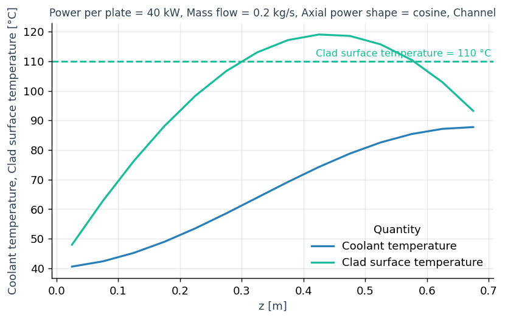
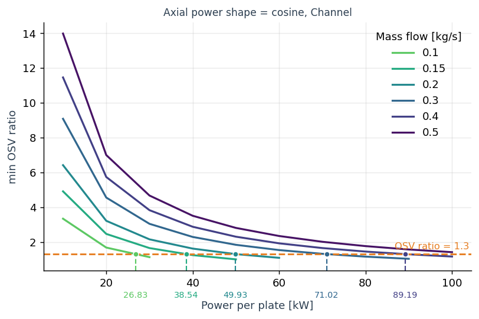
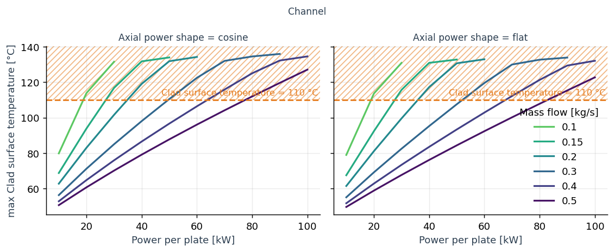
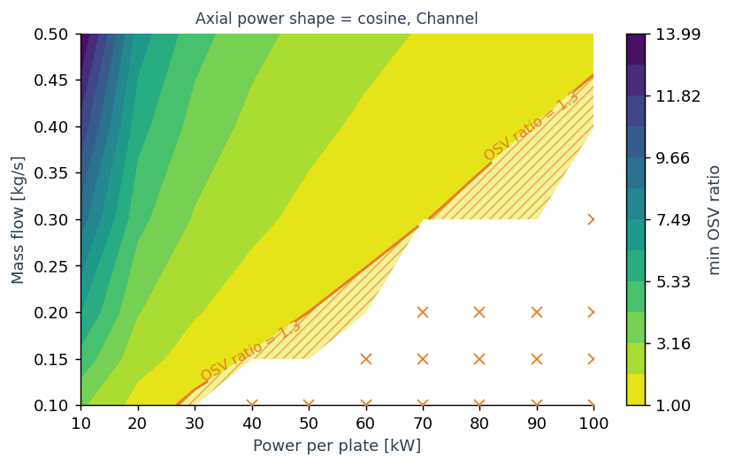
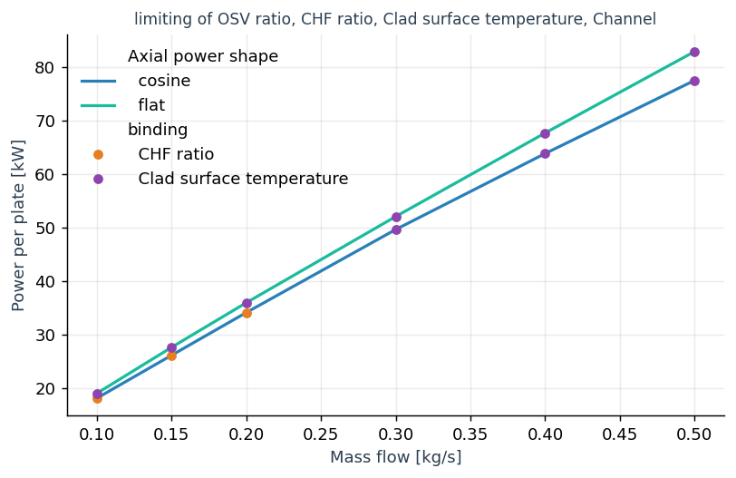

Visualization
=============

:mod:`stream.viz` turns a steady-state parameter sweep into figures and tidy data.
Build a :class:`~stream.viz.Sweep` from the cases and their result frames, ask it a question, and call ``.plot()`` on the answer, or read its ``frame``.
In the example, ``model(**case)`` solves one case and returns its ``State.to_dataframe()``, and ``agr`` is the aggregator the states came from.

.. code-block:: python

    from stream.viz import Sweep, cases, run_cases, at_least, at_most

    cases_ = cases(power=[20e3, 40e3, 60e3, 80e3], mdot=[0.2, 0.3], shape=["cosine", "flat"])
    frames = run_cases(model, cases_)
    sweep = Sweep(cases_, frames, agr,
                  labels={"power": ("Power per plate", "kW", 1e-3),
                          "mdot": ("Mass flow", "kg/s"),
                          "shape": ("Axial power shape", ""),
                          "OSVR": ("OSV ratio", ""),
                          "CHFR": ("CHF ratio", ""),
                          "T_wall, left": ("Clad surface temperature", "°C")},
                  limits={"OSVR": at_least(1.3), "CHFR": at_least(1.3), "T_wall, left": at_most(110.0)})
    print(sweep)
    sweep.profile(["T_cool", "T_wall, left"], where=dict(power=40e3, mdot=0.2, shape="cosine")).plot()
    sweep.reduce("OSVR", "min", versus="power", where=dict(shape="cosine")).plot(color="mdot", crossing="mark")
    sweep.reduce("T_wall, left", "max", versus="power").plot(color="mdot", col="shape", show_limit="shade")
    sweep.reduce("OSVR", "min", versus=("power", "mdot"), where=dict(shape="cosine")).plot(show_limit="shade")
    sweep.required(["OSVR", "CHFR", "T_wall, left"], solve_for="power", versus="mdot", limiting=True).plot(color="shape")

   ``sweep.profile(["T_cool", "T_wall, left"], where=dict(power=40e3, mdot=0.2, shape="cosine")).plot()``

   ``sweep.reduce("OSVR", "min", versus="power", where=dict(shape="cosine")).plot(color="mdot", crossing="mark")``

   ``sweep.reduce("T_wall, left", "max", versus="power").plot(color="mdot", col="shape", show_limit="shade")``

   ``sweep.reduce("OSVR", "min", versus=("power", "mdot"), where=dict(shape="cosine")).plot(show_limit="shade")``

   ``sweep.required(["OSVR", "CHFR", "T_wall, left"], solve_for="power", versus="mdot", limiting=True).plot(color="shape")``

The figures and this summary come from a larger run of the same model than the example, ten powers by six mass flows, and ``docs/viz_figures.py`` is their complete source; ``print(sweep)`` says what can be asked of a sweep:

.. code-block:: text

   Sweep: 120 cases, 34 holes (0 filled), no uncertainty
     parameters: power [10000, 20000, ..., 100000], mdot [0.1, 0.15, 0.2, 0.3, 0.4, 0.5], shape [cosine, flat]
     Channel: CHF (profile), CHFR (profile), ..., OSVR (profile), ..., T_cool (profile), T_in (scalar), ..., T_wall, left (profile), ...
     Fuel: T (field), T_wall_left (profile), T_wall_right (profile)
     limits: OSVR at least 1.3, CHFR at least 1.3, T_wall, left at most 110
     holes: case 36 (power=40000, mdot=0.1, shape=cosine): scaled_newton failed at iteration 53 (Armijo line search found no descent direction); ||F||=3.906e+06.
            case 37 (power=40000, mdot=0.1, shape=flat): scaled_newton failed at iteration 100 (exceeded maxit=100); ||F||=nan.
            ...

Building a sweep
----------------

Build the case grid and solve every case, or bring cases and frames from your own loop; declare the limits on the sweep.

.. autofunction:: stream.viz.cases

.. autofunction:: stream.viz.run_cases

.. autoclass:: stream.viz.Sweep
   :members: profile, field, reduce, required
   :member-order: bysource

.. automethod:: stream.viz.Sweep.single

.. automethod:: stream.viz.Sweep.levels

.. automethod:: stream.viz.Sweep.case_of

.. autofunction:: stream.viz.at_least

.. autofunction:: stream.viz.at_most

Asking
------

A reducer, the second argument of :meth:`~stream.viz.Sweep.reduce` and the ``reduce`` argument of :meth:`~stream.viz.Sweep.required`, collapses the cells of each case:

=================================================  ==========================================
Reducer                                            Value
=================================================  ==========================================
``"min"``                                          the smallest cell value
``"max"``                                          the largest cell value
``"mean"``                                         the mean weighted by cell size
``at(z=...)``, ``at(x=...)`` or ``at(cell=...)``   the value of one cell
``"where_min"``                                    the coordinate of the smallest value
``"where_max"``                                    the coordinate of the largest value
a callable ``f(values, coords)``                   whatever it returns
=================================================  ==========================================

``limiting=True`` keeps, per case or per level, only the calculation and quantity that bind.

.. autofunction:: stream.viz.at

Plotting
--------

:meth:`~stream.viz.Result.plot` carries every drawing option; labels and the style sheet set how names and figures look.

.. autoclass:: stream.viz.Result()
   :members: plot, ylabel, subtitle

.. autoclass:: stream.viz.Label

.. autoclass:: stream.viz.Labels

.. autoclass:: stream.viz.Style

Steady state only: a frame with a ``time`` column is refused.
